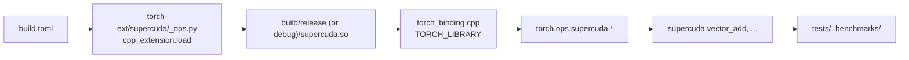

# Parallel

CUDA kernels for learning, called from Python as Torch ops (`torch.ops.supercuda.*`).
The layout follows Hugging Face [kernel-builder](https://huggingface.co/docs/kernels/builder/writing-kernels).

## Layout

```text
SuperCuda/
├── build.toml            # kernel-builder config; also the source list for the JIT build
├── common/common.cuh     # CEIL_DIV, CUDA_CHECK, shared __device__ helpers
├── vector_add_cuda/      # kernel + launcher (takes torch::Tensor)
├── reduction_cuda/       # 5 sum-reduction techniques, one op each
├── sgemm_cuda/           # SGEMM lessons (naive: kernel body TODO)
├── torch-ext/
│   ├── torch_binding.h   # declarations of all launchers
│   ├── torch_binding.cpp # TORCH_LIBRARY registration of all ops
│   └── supercuda/        # Python package: __init__.py (wrappers), _ops.py (dev JIT loader)
├── tests/                # pytest: every op vs. a PyTorch reference
├── benchmarks/           # triton do_bench: time, TFLOPS, GB/s
├── csrc/                 # single-file programs with main() (lessons L1, L2, ...)
├── script/               # build, compdb, sanitizer, ncu, nsys, compile_n_run; setup/ = env install
├── third_party/          # third-party source (CUTLASS submodule: pending)
└── tutorial/             # slides (PDF) and notes/
```

How a Python call reaches a kernel:



## Setup

Use the conda env `cxx`. Activate it before you start VS Code or run a script:
the scripts and `.vscode/` use `$CONDA_PREFIX`.

To install or upgrade the toolchain (CUDA 13.4.3 + torch 2.14.1 for cu132):

```bash
conda activate cxx
conda install --override-channels -c pkgs/main "cuda=13.4.3" -y
pip install "torch==2.14.1" torchvision --index-url https://download.pytorch.org/whl/cu132
conda env config vars set CUDA_HOME="$CONDA_PREFIX" TORCH_CUDA_ARCH_LIST="12.0"   # 8.6 on A10
conda deactivate && conda activate cxx
nvcc --version | tail -2                                                 # 13.4
python -c "import torch; print(torch.__version__, torch.version.cuda)"   # 2.14.1 13.2
```

- `CUDA_HOME` must be the env: `~/.zshrc` sets it to `/usr/local/cuda` (a different nvcc).
- `TORCH_CUDA_ARCH_LIST` limits the JIT build to the local GPU. Without it, the conda nvcc
  activation script sets 9 architectures and every build is slow.
- nvcc 13.4 with torch built for 13.2 is a minor-version mismatch: `cpp_extension` prints a warning only.
- The full install scripts are in `script/setup/`.

## Workflow

All commands run from the repo root, in the `cxx` env.

| Task | Command |
|---|---|
| Build (release: `-O3 -lineinfo`) | `script/build.sh release` |
| Build (debug: `-O0 -g -G`) | `script/build.sh debug` |
| Test | `python -m pytest tests -q` |
| Benchmark | `python benchmarks/bench_reduction.py`, `python benchmarks/bench_sgemm.py` |
| Memory errors | `script/sanitizer.sh memcheck python -m pytest tests/test_vector_add.py -q` |
| One kernel, all metrics | `script/ncu.sh <kernel_regex> <report> python -m pytest tests/test_x.py -q` |
| Timeline | `script/nsys.sh <report> python benchmarks/bench_reduction.py` |
| IntelliSense database | `script/compdb.sh` (after a release build) |
| Standalone program | `script/compile_n_run.sh csrc/helloworld.cu` |

- The first `import supercuda` compiles the extension into `build/<mode>/`. Later imports rebuild only changed files.
  `SUPERCUDA_BUILD=debug` selects the debug build.
- Reports go to `reports/`. Open them with `ncu-ui` / `nsys-ui`.
- `ncu` fails with `ERR_NVGPUCTRPERM` until GPU counters are open to normal users: see the comment in `script/ncu.sh`.
- Profile only the release build. `-G` turns off device optimizations.

### Debug a kernel in VS Code

1. Set a breakpoint in a `*_cuda/*.cu` file.
2. Open the test file that calls the kernel, e.g. `tests/test_vector_add.py`.
3. Start **cuda-gdb: pytest current file**. It builds the debug extension first (`ext: build debug`).

For Python-side bugs, use **Python: pytest current file**.
For a standalone program, open its `.cu` file and start **C/C++: nvcc build and debug active file**.

### Add a kernel

See the checklist in [CLAUDE.md](CLAUDE.md#add-a-new-kernel).

## Resources

### nvidia cuda-c-programming-guide
- [ ] [nVIDIA CUDA Toolkit Documentation](https://docs.nvidia.com/cuda/)
- [ ] [ An Even Easier Introduction to CUDA](https://developer.nvidia.com/blog/even-easier-introduction-cuda/)

### article
- [ ] [A Case Study in CUDA Kernel Fusion](https://arxiv.org/abs/2312.11918)

### blog
- [ ] [How to Optimize a CUDA Matmul Kernel for cuBLAS-like Performance: a Worklog](https://siboehm.com/articles/22/CUDA-MMM)
### cuda code sample
- [x] [tutorial-viblo](https://viblo.asia/s/lap-trinh-song-song-0gdJzv6kJz5)
- [x] [cuda-tutorial](https://cuda-tutorial.readthedocs.io/en/latest/)
- [x] [CoffeeBeforeArch](https://github.com/CoffeeBeforeArch/cuda_programming)
- [ ] [cuda-code-sample](https://cuda-tutorial.github.io/)
- [x] [vietnamen-wordpress](https://vietnamen.wordpress.com/2009/10/03/ph%e1%ba%a7n-2-cuda-programming-model/)
- [x] [supercomputingblog](http://supercomputingblog.com/category/cuda/)
- [ ] [https://modal.com/gpu-glossary](https://modal.com/gpu-glossary/device-hardware/special-function-unit)

### nvidia tool usage
- [ ] [NgoHuuGiaHuy](https://viblo.asia/s/cach-su-dung-nvidia-tools-PwlVmRAw45Z)
- [ ] [debug in Linux with VScode](https://viblo.asia/p/debug-cuda-code-tren-visual-studio-code-cung-nvidia-nsight-visual-studio-code-edition-obA46Ow9JKv)

### Technique
- [ ] tiled [nichijou](https://nichijou.co/cuda7-tiling/) , [blog/tiled-matrix-multiplication](https://penny-xu.github.io/blog/tiled-matrix-multiplication) , [tiling in cuda](https://www.google.com/search?q=tiling+in+cuda&oq=tiling+in+cuda&gs_lcrp=EgZjaHJvbWUyBggAEEUYOTIKCAEQABiGAxiKBTIKCAIQABiGAxiKBdIBCTIxNjUzajBqN6gCALACAA&sourceid=chrome&ie=UTF-8)
- [ ] tuning
- [ ] fused kernel
- [ ] [Nvidia® Tensor Memory Accelerator(TMA)](https://research.colfax-intl.com/tutorial-hopper-tma/)
